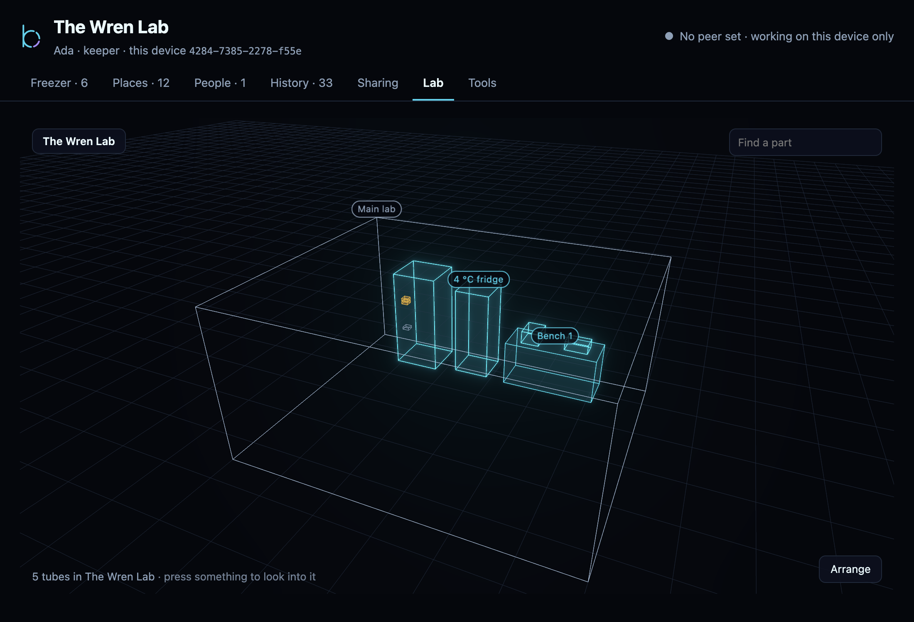
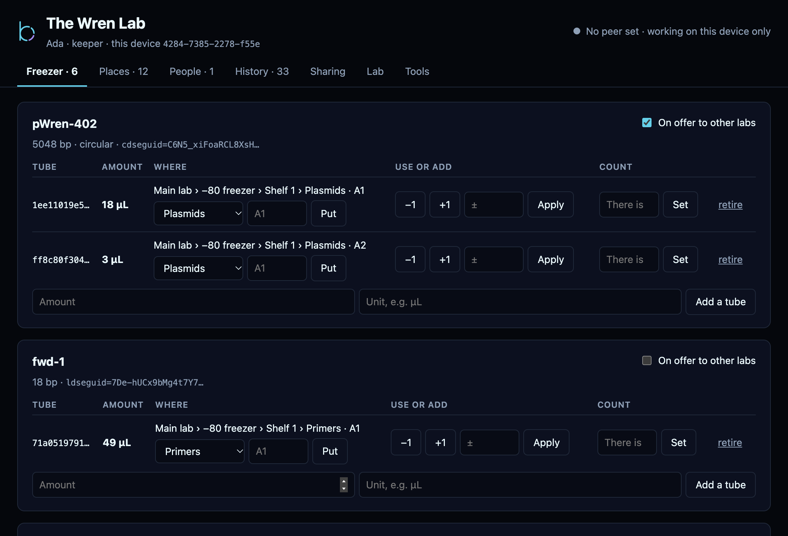
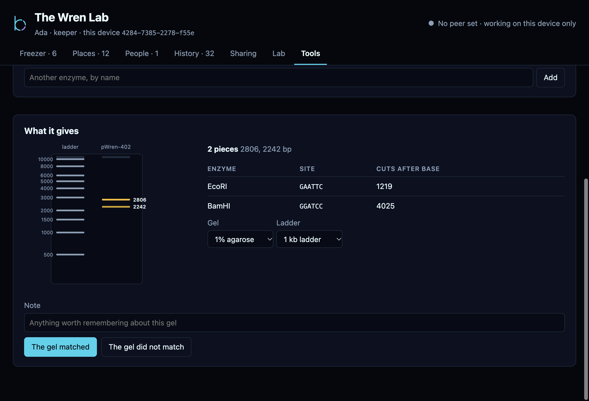

# Bionet desktop

A lab's freezer, kept by the people in the lab. It works with no network, and syncs when there is one.



| | |
|---|---|
|  |  |

## What you do with it

The window has eight tabs.

- **Freezer.** Parts, known by the checksum of their sequence, and the tubes of each. Use some, add
  some, count what is there, say which box and position a tube is in. A tube a run made says which
  run, and from what.
- **Places.** Where things are kept, as a tree: a room, a freezer in it, shelves, boxes. A box has
  positions, so a tube is found by letter and number.
- **People.** Who is in the lab, and letting somebody in. Backing up this device's key, and keeping
  a copy of the whole lab.
- **History.** Every signed change, in words, and what became of it.
- **Sharing.** What other labs are shown, and the lab's web peer.
- **Lab.** The lab drawn in three dimensions, from the whole room down to one position in a box.
  Arrange it by hand: drag, turn, resize, add and retire places. Press an instrument to use it.
- **Tools.** PCR and a check digest with its gel, run from the tubes the lab holds. Recording a run
  takes what was used from each tube, and a PCR's product becomes a new tube. PCR is shown at the
  thermocycler: the machine, its block and its screen, and then what the machine does not show —
  the strands parting, the primers landing and the copies being made, with your real bases at the
  primer's site. A whole programme can be run, and motion can be turned off.
- **Glossary.** Sixty terms, each with a picture, and whether a biologist has reviewed it. The tools
  explain their own terms when one is hovered.

## What it is

Each person runs this on their own computer. Everything they do — add a part, add a tube, use some,
count what is left, let somebody into the lab — becomes a **signed entry in that device's own log**,
kept in a SQLite file beside the app. Nobody writes to anybody else's log, so two people working
offline cannot overwrite each other. What the lab holds is worked out from all the logs together by
[`@biolibs/bionet`](https://www.npmjs.com/package/@biolibs/bionet), the same way on every machine.

The lab's **web peer** (see [lab-wren](https://github.com/matthewlovestocode/lab-wren)) is a server at
the lab's address that holds a copy and passes changes between members who are never online together.
It has no key, so it cannot change anything. The app works without it and catches up when it is there.

- **The device's key stays on the computer**, sealed by the operating system's keychain. One person
  with two computers is two devices on the roster. The one way out is a backup you make yourself:
  the key sealed under a passphrase into a file, to open on a new device if this one is lost.
- **A key is not the lab.** The lab is every signed change, and "Keep a copy of the lab" writes them
  all to a file. With that and the key's backup, a lab comes back on a new computer with nothing
  else to ask. Keep both somewhere that is not this computer.
- **Amounts are whole numbers of a unit**, recorded as differences. Two people each using a tube are
  two uses. A recount says what is physically there.
- **A change the lab would refuse is never written.** A log is forever, so the app tries a change
  against the lab first and says why if it will not go.
- **The window has no powers.** It cannot read files, reach the network or see the key. It can ask for
  the lab's state and for one of a fixed list of things to be done.

## Running it

```
npm install
npm run dev
```

A second device on the same machine, for trying two members side by side:

```
npm start -- --profile=bob
```

## Working on the packages

Nearly every change to this app is a change to a package in [biolibs](https://github.com/matthewlovestocode/biolibs).
With a checkout of it beside this one, the app can use those packages as they are on disk, so a
change is tried without publishing anything:

```
npm run local           # use the packages in ../biolibs
npm run local:status    # say which are in use
npm run local:off       # put the published ones back
```

While linked, keep the packages built with `npx tsc -b --watch` in biolibs, and `npm run dev` here
picks up what changed. Only folders inside `node_modules` are replaced: `package.json` and the
lockfile are not touched, and `npm install` undoes it. Set `BIOLIBS` if the checkout is somewhere
else.

## Joining a lab

1. The new member opens the app, says who they are, and sends a keeper **their device's key**.
2. A keeper adds that key under People, and sends back the **invitation**.
3. The new member pastes the invitation. The lab arrives once the keeper's change has reached the peer.

## Trying it without a person

```
npm run try-app
```

runs the real app as two devices, driven through the same door the window uses, against the real web
peer from `../lab-wren` (run `npm run build` there first), photographing each step.

A script given with `--script` can also work the window as a person would, which is how the Lab tab
and the tools are tried: `["click", [x, y]]` presses a point, `["ui", "…"]` runs a line in the page
(to choose from a list, or press a button by its words), `["shot", "file.png"]` takes a picture on
the way, and `["wait", ms]` pauses.

## It owns nothing

Everything a member can do is in [`@biolibs/bionet-client`](https://www.npmjs.com/package/@biolibs/bionet-client).
The tabs are in [`@biolibs/bionet-panels`](https://www.npmjs.com/package/@biolibs/bionet-panels),
the three-dimensional lab in [`@biolibs/bionet-scene`](https://www.npmjs.com/package/@biolibs/bionet-scene),
the bench tools in [`@biolibs/bionet-tools`](https://www.npmjs.com/package/@biolibs/bionet-tools),
and the glossary in [`@biolibs/glossary-react`](https://www.npmjs.com/package/@biolibs/glossary-react).
Every colour, and the mark, is in [`@biolibs/bionet-theme`](https://www.npmjs.com/package/@biolibs/bionet-theme).
This repository holds only what the desktop can do that nothing else can:

```
src/main/main.mjs      the device's key sealed by the keychain, the window, the entries in a SQLite file,
                       and saving a file where the person chooses
src/main/preload.cjs   the door between the window and the lab: state, one of a fixed list of actions,
                       copy, save
src/renderer/main.tsx  makes that door look like any other lab, hands it to the panels, and adds the
                       Lab, Tools and Glossary tabs to their window
```

A web page that wanted the same application would differ only in those three files.

## Not yet

- Removing somebody from the lab (the rule exists in `@biolibs/bionet`; there is no button).
- Editing a part's or a tube's fields, and renaming a place.
- Putting a tube in a box by dragging it. It is typed as a position on the Freezer tab.
- Keeping a cut piece from a digest, and assembly as a tool. Both wait on a part being able to say
  what ends it has.
- Looking at a sequence: a map, features, cut sites.
- Choosing which other labs this one points at. Publishing keeps the pointers already published.
- Direct connections between devices. Everything goes through the web peer.
- Installers, signing and updates. It runs from source.

## License

MIT. See [LICENSE](LICENSE).
